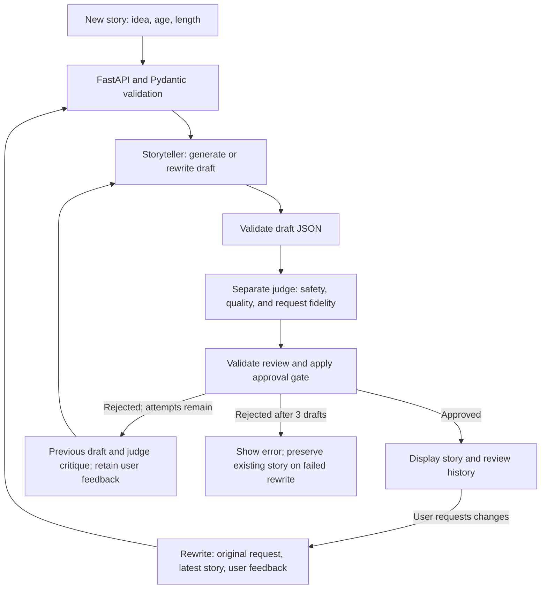

# Moonbeam submission

## What I built

Moonbeam creates bedtime stories for children ages 5–10 from an idea, age, and preferred length. A responsive browser UI shows generation progress, the approved story, an expandable quality review, and a text download. Users can request changes through a feedback form; each rewrite is reviewed before replacing the current story.

The Python backend separates HTTP routes, validation, prompts, provider calls, and the generation/review loop. See [SETUP.md](SETUP.md) for installation and running instructions.

## Architecture

User feedback starts a new generation/review cycle. Judge feedback drives internal revisions within that cycle; each cycle allows up to three drafts.

Storyteller and judge use the selected provider with separate system prompts in [backend/prompts.py](backend/prompts.py). API keys stay on the server. The frontend renders stories as text, and the application does not persist prompts or stories.

## Quality and revision loop

1. **Validate input.** Accept an idea of 3–1,200 characters, age 5–10, and short or long length. Prompts treat user content as untrusted and direct unsafe themes toward gentle alternatives.
2. **Write a draft.** Request a lovable protagonist, small challenge, kind choices, clear resolution, and calming ending. Short stories target 220–400 words; long stories target 400–650.
3. **Judge separately.** A second model call returns a safety boolean, actionable feedback, and 1–5 scores for age fit, story arc, warmth, bedtime calm, and fidelity to safe user intent.
4. **Apply the gate.** Require `safe=true`, every score at least 4/5, and a word count within range. Pydantic validates story and review output; interrupted completions are rejected.
5. **Revise if needed.** Send the previous draft and critique back to the storyteller, then judge the replacement. Allow two revisions: at most three drafts and six model calls per request. If none passes, return an error without displaying a rejected draft.

Responses include review history and the number of internal revisions. Unchecked drafts are never streamed to the browser.

## User feedback

For a rewrite, the browser sends the original request/settings, latest story, and feedback. Both storyteller and judge receive the feedback, including during internal revisions, so the review checks whether requested changes were addressed. Feedback and a previous story must be provided together.

The frontend prevents duplicate submissions and preserves the current story and feedback if a rewrite fails. The story stays in browser memory until refresh or replacement.

## Model choice

I selected **Gemini 2.5 Flash-Lite (`gemini-2.5-flash-lite`) for development/testing** to reduce iteration costs through its available free tier. **Claude Haiku 5.5 (`claude-haiku-5-5`) is configured as the submission model** and is the code/template default. Switching requires only the provider and API key in `.env`, followed by a restart. Both roles use the selected provider; there is no automatic fallback.

The shared adapter in [backend/llm.py](backend/llm.py) uses provider-specific SDK calls:

| Provider | SDK call | System prompt | JSON handling |
| --- | --- | --- | --- |
| Gemini | `client.models.generate_content(...)` | `config.system_instruction` | JSON response mode, then Pydantic validation |
| Claude | `client.messages.create(...)` | Top-level `system` | Prompt requests JSON, then Pydantic validation |

Both paths use the same prompts, schemas, quality thresholds, and revision budget. This does not imply equal output quality. Gemini free-tier eligibility, quotas, and billing depend on the account; no comparative model-quality claim is made.

## Validation and limitations

The offline suite covers approval, revision and rejudging, exhausted revision budgets, malformed/interrupted output, input validation, API failures, frontend serving, and user-feedback propagation. SDK tests use mocked HTTP transports to check both providers' request and response formats. Run it using the instructions in [SETUP.md](SETUP.md).

No live-model evaluation results are claimed. AI judge scores are subjective, and using the same model for writing and judging can produce correlated errors. Prompt separation is not an injection guarantee; stories still need adult review. Public deployment would also need authentication and usage limits.

## With two additional hours

I would build a small human-reviewed evaluation set covering reading levels, unsafe requests, prompt injection, and judge disagreement, then use it to improve prompts and compare providers. I would also add progress updates showing the current generation/review stage.

The requested code note is at the top of [backend/storyteller.py](backend/storyteller.py).
